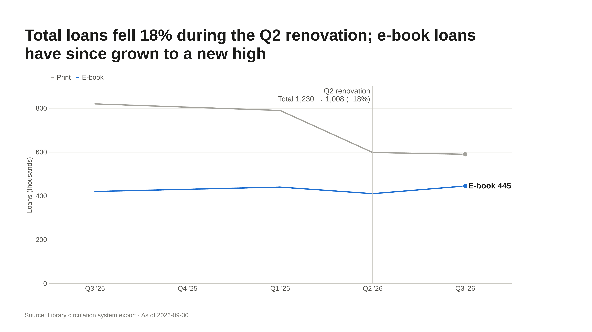

# plotpoint

> **Early stage (v0.1.0).** Tested on an invented write-up; not yet used on real
> work. See [`HANDOFF.md`](HANDOFF.md) for current state.

**Make every chart earn its place.** A Claude skill for storytelling with data:
plan the visuals in a write-up around its audience and questions, then render
checked charts to Markdown, HTML and slides.

A *plot point* is the moment in a story that changes its direction, and a point
on a chart. plotpoint helps make the second do the job of the first.

---

## Purpose: storytelling with data

Most charts fail not because they're ugly but because they don't answer the
reader's question. plotpoint starts from **who reads it and what they must
decide**, plans the visual story across a whole write-up, and then draws each
visual so its takeaway is obvious.

- **Storyboard** a write-up: what to show, in what order, for which audience,
  what to merge, demote to a table, or cut, and one color scheme throughout.
- **Render** each visual: a takeaway headline, the right form, emphasis on what
  matters, and every number checked against the data, in Markdown, HTML or a
  slide image.

It advises; you (or your calling skill) decide. It never invents a conclusion:
headlines written without your takeaway are marked as drafts.

## What you get

| Input | Output |
| --- | --- |
| Questions, audiences and datasets (CSV, TSV, JSON, JSONL or inline), optionally your draft | An ordered storyboard: each visual's intent, placement (summary, body, appendix), the technique per format, recommendations, a color map |
| One dataset plus a question or a planned intent | SVG, PNG, Mermaid, tables or HTML fragments per format, with a ready-to-paste snippet and check results |

Formats: Markdown (SVG image, Mermaid or table), HTML fragments (inline SVG or
interactive), HTML slide canvases, and slide images (PNG 3840 × 2160).
Rendered in v1: bar, stacked bar, line, scatter, histogram, table, single
number, sentence.

Example output (invented data):



More in [`docs/examples/library-review/`](docs/examples/library-review/).

## Install

### Claude Code

```bash
claude plugin marketplace add ndany/plotpoint
claude plugin install plotpoint@plotpoint
```

### Claude.ai, Cowork and the desktop app

**Customize → Plugins → Add → Add marketplace**, enter `ndany/plotpoint`, then
add the plugin. It syncs to your account, so it's also available in Cowork and
Claude Code. (On Team and Enterprise plans an owner may control which
marketplaces members can add.)

### Script dependencies

The skill's scripts need Python 3.11+ and three packages. With
[uv](https://docs.astral.sh/uv/) installed there is nothing to do: the skill runs
`uv run .../visualize.py`, which installs them on first use. Without uv,
`visualize.py` stops (exit code 3) and prints the exact commands for your OS: a
virtual environment in the per-user cache folder (macOS `~/Library/Caches/plotpoint/venv`,
Windows `%LOCALAPPDATA%\plotpoint\venv`, Linux `~/.cache/plotpoint/venv`) plus
`pip install -r scripts/requirements.txt` into it. Claude shows you that message
rather than installing anything itself. Once that venv exists, `visualize.py` finds and
uses it automatically.

Optional: the Mermaid CLI (`npm install -g @mermaid-js/mermaid-cli`) to
render-test Mermaid output. Recommended: Anthropic's **dataviz** skill (bundled
with Claude), whose rendering method plotpoint applies.

## Use

Ask in plain language ("storyboard this write-up", "chart this dataset for the
board deck"), or invoke it directly: `/plotpoint:visualize`. For integrating it
into another skill, see the [guide](docs/guide/using-plotpoint.md).

## How it fits together

| Layer | Owner | Responsibility |
| --- | --- | --- |
| Storytelling | **plotpoint:visualize** | Questions, audiences, order, form, headline, emphasis, per-format technique |
| Rendering method | dataviz (Anthropic) | Color validation, marks, accessibility |
| Domain knowledge | planned, separate | Metric definitions and conventions for a field |

## Documentation

| Document | For |
| --- | --- |
| [Try it](docs/guide/try-it.md) | A hands-on tour on invented data, with and without Claude |
| [Guide](docs/guide/using-plotpoint.md) | Calling plotpoint from a skill or by hand |
| [Spec](plugins/plotpoint/skills/visualize/references/spec.md) | Every request and result field |
| [Targets and layouts](plugins/plotpoint/skills/visualize/references/targets.md) | Formats, techniques, widths, capacity |
| [Architecture](docs/architecture.md) | How it's built and why |
| [Decisions](docs/decisions.md) | Choices, alternatives, trade-offs |
| [Testing](docs/testing.md) | Fixture, test modes, recorded runs |
| [Design notes](plugins/plotpoint/skills/visualize/DESIGN.md) | Skill rationale and test findings |

## Repository layout

```text
plotpoint/
├── .claude-plugin/marketplace.json    # Marketplace catalog
├── plugins/plotpoint/
│   ├── .claude-plugin/plugin.json     # Plugin manifest
│   └── skills/visualize/
│       ├── SKILL.md                   # What Claude follows
│       ├── references/                # Spec, targets, profiling, storyboard
│       ├── schemas/                   # Request and result contract
│       ├── config/                    # Layout presets, theme, capacity
│       └── scripts/                   # visualize.py and the ppviz engine
├── docs/
│   ├── guide/                         # Try-it tour and caller guide
│   ├── examples/                      # Generated worked example
│   ├── plans/                         # Dated plans
│   ├── architecture.md                # How it's built and why
│   ├── decisions.md                   # Decisions and trade-offs
│   └── testing.md                     # Test map and recorded runs
├── scripts/                           # Quality gates and dev helpers
├── tests/                             # pytest suite and the fixture
├── CLAUDE.md                          # Conventions for Claude Code
└── HANDOFF.md                         # Current state, next steps, backlog
```

## Development

```bash
python3 -m venv .venv && .venv/bin/pip install -r requirements-dev.txt
npm install                                  # markdownlint
git config core.hooksPath .githooks          # pre-commit checks
scripts/check-all.sh                         # every gate CI runs
```

See [`CLAUDE.md`](CLAUDE.md) for conventions.

## License

Apache License 2.0: see [`LICENSE`](LICENSE) and [`NOTICE`](NOTICE). Use,
modify and redistribute it freely, including commercially; keep the `NOTICE`
file when you redistribute, so credit to the works plotpoint builds on travels
with it.

## Acknowledgments

plotpoint builds on From Data to Viz, ColorBrewer, Dashboard Design Patterns,
Storytelling with Data, the FT Visual Vocabulary, Stephen Few's dashboard work,
the Okabe–Ito palette, Vega-Lite and Anthropic's dataviz skill. See
[`ACKNOWLEDGMENTS.md`](ACKNOWLEDGMENTS.md). None of their authors is affiliated
with or endorses this project.
