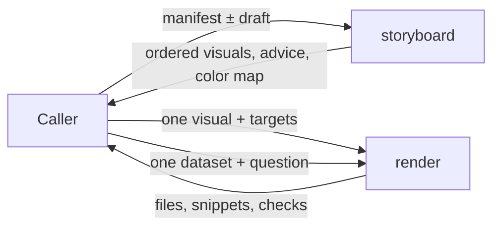

# Architecture

How plotpoint is put together and why. Decisions and their trade-offs are
logged in [`decisions.md`](decisions.md); field-level detail lives in the skill's
[`references/spec.md`](../plugins/plotpoint/skills/visualize/references/spec.md).

## Purpose

**Better storytelling with data.** plotpoint helps a calling skill (or a person)
decide what each dataset should show, in what order, for whom, and how it's
drawn in Markdown, HTML and slide images. Charts are the means; the reader's
question is the point.

## Who owns what

| Owner | Responsibility |
| --- | --- |
| **Caller** (e.g. a write-up skill) | Questions, analysis and prose; producing each summarized dataset; final order and placement; figure numbers and captions; the page or document |
| **plotpoint: storyboard** | Advice across the whole set: order, merge, demote, cut, audience placement, one color map, the technique per target |
| **plotpoint: render** | One visual: decide its intent if not given, draw it per target, run checks |
| **dataviz** (Anthropic, bundled with Claude) | The rendering method plotpoint applies: palette method and validator, mark specs, accessibility, anti-patterns |

**Boundary rule:** plotpoint advises; the caller decides. plotpoint never
invents an analytical conclusion: without the caller's takeaway, a headline is
marked `draft`.

## Layers

| Layer | Where | Does |
| --- | --- | --- |
| Instructions | `skills/visualize/SKILL.md`, `references/` | Judgment: the story, the form, the headline, outlier handling |
| Contract | `schemas/plotpoint.schema.json` | Requests and results, validated at every step |
| Engine | `scripts/ppviz/` | Deterministic: load, profile, shape, draw, check |
| Configuration | `config/*.yaml` | Layout presets, theme, capacity limits; tuned without code changes |

Before the engine loads, `scripts/bootstrap.py` (standard library only) checks the
Python version and that each dependency imports. If not, it re-runs `visualize.py` with the
cache venv's Python when that exists, else `visualize.py` exits 3
with the per-OS setup commands and does no work; with `uv run`, the PEP 723 block
in `visualize.py` (kept identical to `requirements.txt` by a test) installs the
dependencies instead.

The split matters: judgment stays with the model, where it belongs, and
everything that can be computed (numbers, sizes, colors, checks) is computed in
code, so it's repeatable and testable.

## Operations and modes



| Mode | Call | Input |
| --- | --- | --- |
| A. Whole write-up | storyboard | Manifest plus the draft |
| B. All datasets | storyboard | Manifest only |
| C. One at a time | render | A question and a dataset; the model decides the intent |
| D. Planned visual | render | An intent from storyboard |

Both operations are stateless. A caller typically runs storyboard once, then
loops render over the visuals, passing the color map each time.

**Why storyboard exists.** Per-visual calls can't see the whole story. Seeing
every question and dataset lets storyboard recommend order, merges, demotions
and cuts, place visuals by audience (summary, body, appendix), give one color
map for the whole document, and choose the best technique per format.

## The render pipeline

```text
render request
  │
  ├─ validate      the request against the schema
  ├─ load data     path or inline CSV → typed table
  ├─ profile       stats, outlier flags, extreme rows
  ├─ shape         per target: plotted rows, exclusions, capacity
  ├─ draw          Vega-Lite, Mermaid, table or text
  ├─ package       deliverable file (.md, .html, .png) and snippet
  ├─ check         headline numbers, outliers, callouts,
  │                legibility, capacity, render
  ▼
result (also written to <out_dir>/<id>.result.json)
```

`render --dry-run` runs the same pipeline into a scratch folder and returns only
the checks; storyboard uses it to confirm each planned visual will render.

| Module | Role |
| --- | --- |
| `data.py` | Load `path` (csv, tsv, json, jsonl) or `inline` CSV; infer types |
| `profile.py` | Distribution stats, outlier and dominance flags, extreme rows, deterministic sample |
| `layout.py` | Target + layout → sizes; raises text for legibility |
| `shape.py` | Intent + data → plotted rows; exclusions; capacity changes |
| `colors.py` | Highlight and color map → entity colors; never cycles |
| `vl.py` | Vega-Lite specs per visual type |
| `mermaid.py` | Mermaid `xychart` source; validation with the Mermaid CLI |
| `tables.py` | Markdown and HTML tables; number parts |
| `output.py` | Inline SVG prep, HTML fragments, Markdown snippets, slide composition |
| `checks.py` | The checks |
| `render.py` | Orchestrates one visual across targets |

## Intent vs rendering

Each visual has one **intent** (type, headline, fields, highlight, callouts,
outlier handling) that is identical across formats, and a **technique** per
target. When a format can't carry part of the intent, the rendering compensates
and says so: Mermaid can't draw callouts, so they become text under the chart.

## Context strategy

Everything Claude reads uses its context window. plotpoint keeps data rows out
of it:

- **Profiles, not rows:** storyboard reads a compact profile per dataset.
- **Numbers in code:** every number in a headline is checked against the data
  by script.
- **Files, not inline:** the renderer reads files directly.
- **Sub-agent (optional):** a caller can run storyboard in a sub-agent and keep
  only its result (Claude Code and Cowork).

## Layout and the scaling rule

An SVG drawn at one width and shown at another scales everything in it, text
included. So the renderer draws at the content width the chart will occupy,
never scales up (`max-width` = design width), and raises text sizes so labels
stay at 11 px or more at the narrowest expected display width. Presets come
from in-use page conventions; `report` (960) is the default. Details:
[`references/targets.md`](../plugins/plotpoint/skills/visualize/references/targets.md).

## Outliers

Profiles flag outliers (1.5 × IQR) and dominance (max > 10 × median), and keep
the rows holding extremes. When a plotted measure is flagged, the intent must
handle it explicitly (callout, log scale, exclude with a reason, or accept with
a reason), per column when columns need different treatment; the `outliers`
check fails otherwise. Skew is informational and tables are exempt. Rendering
always uses the full data.

## Dependencies

| Dependency | Why | Licence |
| --- | --- | --- |
| `vl-convert-python` | Renders Vega-Lite to SVG and PNG offline, and SVG to PNG | BSD-3-Clause |
| Source Sans 3 (bundled in `fonts/`) | Slide-image font, registered with vl-convert so PNGs don't depend on system fonts | OFL-1.1 |
| `jsonschema` | Validates requests and results | MIT |
| `PyYAML` | Reads YAML requests and config | MIT |
| Mermaid CLI (`mmdc`), optional | Render-tests Mermaid output | MIT |
| dataviz skill, recommended | Rendering method; fallback rules ship in the skill | Anthropic (bundled) |

## Limits in v1

- Eight visual types are rendered (five charts, table, number, sentence); other
  chooser forms are recommended but drawn by hand.
- Tables and sentences aren't rendered as slide images.
- No dark-mode variants of static SVGs.
- Render takes one dataset; merging datasets is the caller's job.
- The headline check confirms a number can be derived from the data, not that
  the sentence describes the right comparison; the "look at it" step covers that.
- Label positions are automatic; a callout can land on a gridline or another
  label, and only looking catches it.
