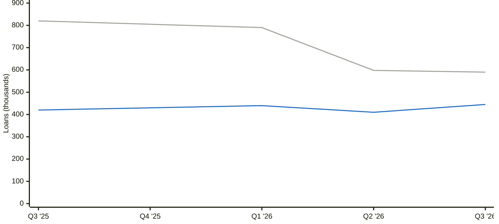
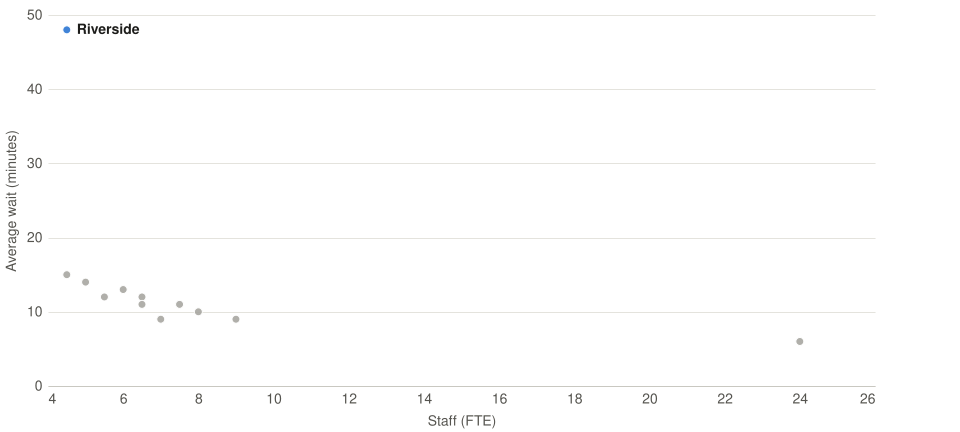
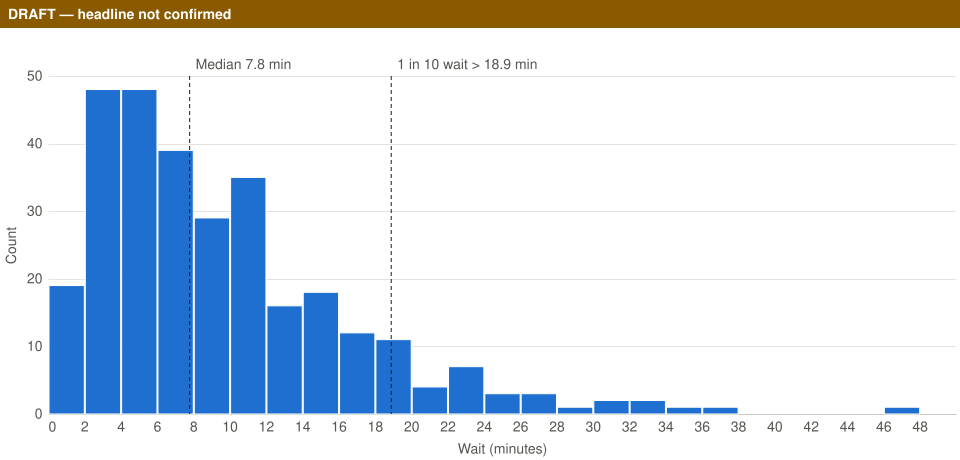

# Example: library services review (invented data)

Rendered by `plotpoint:visualize` from the reference storyboard of the test
fixture (`tests/fixtures/library-review/`). Every number is invented. Visuals
appear in the storyboard's order; the comment above each gives its placement and
audience. The same intents rendered for HTML are in [`page.html`](page.html),
and the charts have slide images in `figures/` (e.g.
[`v1-image-slide.png`](figures/v1/v1-image-slide.png)).

Generated by `scripts/build_examples.py`; don't edit by hand.

---

<!-- v1: summary, for board, managers -->

**Total loans fell 18% during the Q2 renovation; e-book loans have since grown to a new high**

- Lines: Print (gray), E-book (blue, highlighted)
- Q2 renovation: Total 1,230 → 1,008 (−18%)

Source: Library circulation system export · As of 2026-09-30

---

<!-- v2: summary, for board -->

<!-- plotpoint: draft headline; confirm before publishing -->

**The library has 48,210 active members, up 3.2%**

**48,210** Active members (+3.2% vs 46,700)

Source: Membership system · As of 2026-09-30

---

<!-- v3: body, for managers -->

**Riverside's average wait is 48 minutes, far above every other branch**

- Central is the largest branch (24 FTE); its short wait is expected for its size

Source: Branch visit survey · As of 2026-09-30

---

<!-- v4: appendix, for managers -->

<!-- plotpoint: draft headline; confirm before publishing -->

**Branch operations at a glance: Central carries the most activity**

| Branch | Visits (k) | Open hours | Staff (FTE) | Events |
| --- | ---: | ---: | ---: | ---: |
| Central | 212 | 68 | 24 | 96 |
| **Riverside** | **96** | **54** | **4.5** | **22** |
| Northgate | 88 | 52 | 9 | 30 |
| Elm Park | 74 | 48 | 8 | 28 |
| Harbor | 69 | 48 | 7.5 | 25 |
| Westfield | 65 | 46 | 7 | 21 |
| Oakdale | 61 | 46 | 6.5 | 19 |
| Southbank | 58 | 44 | 6.5 | 18 |
| Hillcrest | 52 | 42 | 6 | 16 |
| Lakeside | 47 | 40 | 5.5 | 15 |
| Mill Road | 41 | 38 | 5 | 12 |
| Eastgate | 38 | 36 | 4.5 | 11 |

Source: Branch operations report · As of 2026-09-30

---

<!-- v5: body, for managers -->

<!-- plotpoint: draft headline; confirm before publishing -->

**Half of visitors wait under 8 minutes, but one in ten waits more than 19**

Source: Branch visit survey, individual visits · As of 2026-09-30
