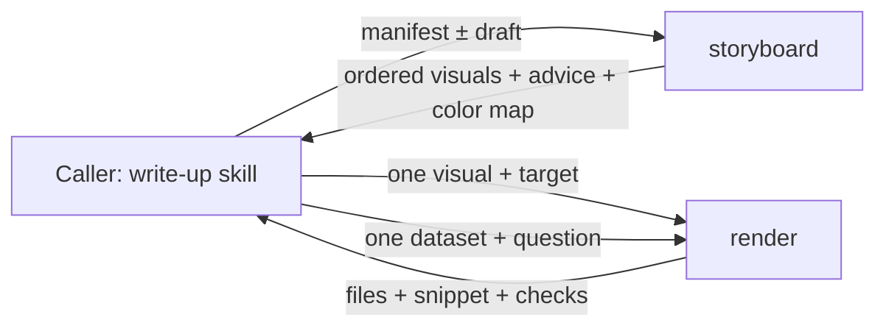

# Plan: plotpoint v1 design (2026-11-01)

> **Status: approved, revision 3; built 2026-11-01.** Changes made during the
> build in response to testing are recorded as decisions D-20 to D-23 and in the
> skill's `DESIGN.md`, not here. It supersedes the earlier
> `storytelling` draft, which was never committed or tested; v1 is treated as a
> new first version.
>
> **Revision 3 (2026-11-01):** skill named `visualize`, with storytelling stated
> as plotpoint's purpose (§1, §10); `report` (960) confirmed as the default
> layout (§7); the intent gains the fields the renderer needs: `fields`,
> structured `callouts`, `outlier_handling` (§8); Mermaid facts verified by
> rendering at 11.16 in the build sandbox (§7, §12). No open questions remain.
>
> **Revision 2 (2026-11-01):** one skill confirmed (§10); data input simplified
> to `path` or `inline` with more file formats (§4); explicit outlier and
> distribution handling in profiles (§5); layout widths reworked into presets
> plus caller overrides, with the scaling rule that drives them (§7); testing
> gets its own durable document (§11, §12); hub marketplace deferred (§14).
>
> **This plan is a point-in-time record.** Its durable parts move into the
> documents listed in §11 as they're built; the plan itself stays as history.

## 1. Goal

**plotpoint's purpose is better storytelling with data.** Charts are the means:
every choice it makes (what to show, in what order, where, how it's drawn)
serves the story the reader needs to follow and the question they need answered.

Concretely: give any calling skill (for example, a skill that writes
data-analysis write-ups) a reliable way to **plan** the visual story across a
whole write-up, **decide** how each dataset should be shown, and **draw** it well
in Markdown and HTML, including slide-shaped output.

### Non-goals (v1)

- Writing the analysis, prose or narrative. The caller owns that.
- Native `.pptx` files. Slide output is an image or an HTML fragment.
- Rendering every chart type in the chooser. v1 renders seven types well;
  others are recommended but drawn with best effort and flagged.
- Domain metric libraries (planned as a separate plugin).

## 2. Who owns what

| Owner | Responsibility |
| --- | --- |
| **Caller** (e.g. write-up skill) | Questions, analysis, prose; producing each summarized dataset; final order and placement; figure numbers and captions; the page or document itself |
| **plotpoint: storyboard** | Advice across the whole set: order, merge, demote, cut, summary-first placement per audience, one color map, the best rendering per target |
| **plotpoint: render** | One visual: choose its type if not already chosen, write the headline, draw it for each requested target, run checks |
| **dataviz** (Anthropic, bundled) | Rendering rules plotpoint applies: palette method, color validation script, mark specs, accessibility, anti-patterns |

**Boundary rule.** plotpoint advises; the caller decides. Storyboard output is a
recommendation, never an instruction the caller must follow. plotpoint never
invents an analytical conclusion (see `headline_status`, §8).

## 3. Operations and modes

plotpoint offers two operations. Both are **stateless**: nothing carries over
between calls except what the caller passes in.



| Mode | Call | Input | Use when |
| --- | --- | --- | --- |
| **A. Whole write-up** | storyboard | Manifest **plus** the draft write-up | You want advice on narrative order, placement and how each existing visual should change per format (e.g. MD → HTML conversion) |
| **B. All datasets** | storyboard | Manifest only (questions, audiences, datasets) | You want visual-level advice before writing prose |
| **C. One at a time** | render | One question + one dataset, no prior intent | Quick single chart; no cross-visual advice |
| **D. Render a planned visual** | render | An intent from storyboard + dataset + targets | The normal follow-up to A or B |

A and B differ only in whether the draft is supplied. C and D differ only in
whether an intent is supplied.

### Why support passing everything at once

Per-visual calls can't see the whole story. Seeing everything lets storyboard
recommend:

| Benefit | Example |
| --- | --- |
| **Order** | Lead with the visual that answers the main question |
| **Merge** | Two datasets that tell one story become one chart |
| **Demote** | A chart with no single takeaway becomes a table or a sentence |
| **Cut** | A visual that answers no question is dropped |
| **Colors** | One color map for the whole document, so entities match across charts |
| **Audience layering** | Summary-level visuals first for decision-makers; detail later or in an appendix (§6) |
| **Per-target rendering** | For each visual, the best technique in each target format (§7) |

This informed the design: storyboard is a separate, optional first step, and
render accepts its output, so the caller can still loop one visual at a time.

## 4. Data: inline or by reference

Both are supported. **The spec field is `data`, and it takes exactly one of
two keys: `path` or `inline`.** Revision 1 had three forms (`path`, `rows`,
`csv`); `rows` and `csv` were two spellings of the same thing, so they merge into
`inline`, which takes CSV text. CSV is the most compact inline form (column
names once, not per row), and summarized analysis data is flat, so nothing is
lost.

```yaml
data: {path: data/loans_by_quarter.csv}       # file: format from the extension
data: {path: data/branches.json}              # JSON array of records
data: {path: exports/wait_times.tsv}          # tab-separated
data: {path: logs/visits.jsonl}               # one JSON record per line
data: {inline: "metric,value\nActive members,48210\n"}   # small summary
```

| Form | Use when |
| --- | --- |
| `path` (default) | The data already exists as a file (the usual case in an analysis pipeline); more than ~100 rows or ~5 KB; the same dataset feeds several visuals |
| `inline` | The caller computed a tiny summary on the fly and writing a file would be overhead |

**File formats in v1:** `.csv`, `.tsv`, `.json` (array of records), `.jsonl`.
Excel and Parquet are deferred: they need heavier dependencies. The size
thresholds are configurable defaults, not hard limits.

**Size handling is the same for both forms:** a script writes inline data to a
temporary file, then profiles and renders from the file exactly as for `path`.
So the choice is about convenience, not capability.

**Why `path` is the default:** the render scripts read the file directly, so
data rows never need to pass through the model's context, and every number in a
headline or callout is computed in code from the file rather than read by eye.

## 5. Context size: the concern and the mitigations

**The concern.** Everything Claude reads takes up its context window (its
working memory for a task). Passing every dataset's rows to storyboard can
crowd out the instructions, slow things down, raise cost, and make the model
more likely to misread a number deep in a long table.

| Mitigation | How | Available in |
| --- | --- | --- |
| **Profiles, not rows** | Storyboard reads a short profile per dataset: columns, types, row count, ranges, a few sample rows. A script generates it from `path` | Everywhere |
| **Numbers in code** | Render computes every figure it cites from the data with a script | Everywhere |
| **Files, not inline** | `path` keeps rows out of context entirely at render time | Everywhere |
| **Sub-agent** | The caller runs storyboard in a sub-agent with its own context; only the storyboard result comes back | Claude Code, Cowork (not chat). Recommended pattern for large write-ups; never required |

With profiles plus code-computed numbers, the size of the datasets mostly stops
mattering. A sub-agent then protects the caller's own context.

### Making sure profiles don't hide outliers

A profile built from a random sample can miss the very values that shape a
chart. Outliers decide the axis range, can flatten everything else, and are
often the story. So the profiler is explicit about them:

| Profile element | What it captures |
| --- | --- |
| **Numeric columns** | min, max, mean, median, quartiles, nulls; **outlier count** by the 1.5 × IQR rule; **skew flag** |
| **Dominance flag** | Set when max ÷ median > 10 (configurable): one value will compress the rest on a linear axis |
| **Extreme rows** | The full rows holding each numeric column's min and max, so the model sees *which* entity is extreme |
| **Categorical columns** | Distinct count, top categories with their share, size of the long tail |
| **Time columns** | Range, interval, gaps, irregular spacing |
| **Sample rows** | Not random only: first rows, last rows, the extreme rows, then a seeded random sample, de-duplicated. Deterministic, so tests can check it |

**How storyboard and render use it:** when outliers or dominance are flagged,
the decision must state how they are handled, never silently:

- **Call it out:** the outlier *is* the story; highlight and annotate it.
- **Change the scale:** log scale, stated in the axis title.
- **Show it separately:** chart the rest, with the outlier as a callout or a
  second small chart.
- **Exclude with a note:** only when the caller confirms it's an error or out of
  scope; the note says what was excluded and why.

Rendering always reads the full data, so outliers are drawn correctly; the
profile only informs the decisions. A render check warns when a flagged outlier
is neither highlighted, annotated nor noted.

## 6. Audiences

A write-up can have several audiences, and so can a single question.

| Level | Field | Example |
| --- | --- | --- |
| Write-up | `audiences` (named list) + `default_audience` | `board` (decision-makers), `managers` (practitioners) |
| Question | `audience: [names]` | Question 1 serves both; question 4 serves managers only |
| Visual | inherits from its question; storyboard may narrow it | A summary visual for `board`, a detail visual for `managers` |

**Effect on order and placement.** Each storyboard visual gets a `placement`:
`summary` (executive summary, read first), `body`, or `appendix`. Decision-maker
visuals that answer the main question go to `summary`; practitioner detail goes
to `body` or `appendix`. The caller makes the final call.

**Effect on the visual.** Audience changes the level of detail, not the facts.
For decision-makers: fewer series, a takeaway headline, the decision stated.
For practitioners: more breakdown, method notes, exact values in a table.

## 7. Targets, layout and rendering techniques

### Intent vs rendering

Each visual has one **intent** that holds across formats: question, visual type,
headline, highlight and callouts. It can have a different **rendering** per
target: the technique that best carries that intent in that format. Example: in
`.md` a simple trend can be a Mermaid chart plus a values table; in HTML it is
an inline SVG with the highlight and callouts drawn in.

If a target can't carry part of the intent (for example, Mermaid has no
callouts), the rendering compensates (callout text under the chart; the
highlighted value in bold in a table) and records the compensation.

### Targets = format + layout

HTML is used as a document and as a slide-like canvas, which need different
sizes. So a target names both a format and a layout.

#### Why width matters: the scaling rule

An SVG chart is drawn at a **design width** and then scaled to fit its
container. Scaling changes the apparent size of everything in it: a chart drawn
at 960 px and shown in an 800 px column shrinks to 83%, so 12 px labels become
10 px; drawn at 720 and shown at 960, it grows to 133% and the text looks
oversized. So:

- **Draw at the content width the chart will actually occupy** (the container
  width minus its padding), within about ±10%.
- **Never scale up:** embed with `width: 100%; max-width: <design width>`, so a
  chart can shrink on a narrow screen but never balloons.
- **Check legibility after scaling:** at the narrowest expected width, labels
  must stay at or above 11 px. The render check computes this.

#### Presets plus overrides

Container widths in practice vary by content type, and in the HTML outputs
reviewed they were chosen for readability on the monitors they're read on. So
plotpoint doesn't standardize on one width. It offers **named presets** based on
those in-use conventions, and **callers override** whenever they know their
page:

| Layout preset | Content width | Typical page |
| --- | --- | --- |
| `prose` | 800 | Document-style reading pages: prose and small tables |
| `report` (**default**) | 960 | Table-heavy analysis reports; the most common width in the outputs reviewed |
| `wide` | 1100 | Diagram-first or illustrated pages |
| `dashboard` | 1200, divided into cards | Card grids: chart width = card width |
| `deck` | 1440 × 810 canvas | Fixed-canvas HTML slide decks |
| `slide-image` | 1920 × 1080 | Images for PowerPoint, Keynote, Google Slides |

The earlier placeholder of 720 px was a generic prose-column guess (about 65–75
characters per line at 16 px), not evidence; it's replaced by the presets.

| Target | Default layout | Type scale |
| --- | --- | --- |
| `md/document` | `report`; VS Code and GitHub widths vary with the window, and the SVG scales down | 1× |
| `html/document` | `report` | 1× |
| `html/slide` | `deck` | about 1.6× |
| `image/slide` | `slide-image`, **PNG rendered at 2× (3840 × 2160 px)**; SVG also offered | 2× |

**Overrides per request:** `layout: {preset: prose}`, or exact numbers:
`layout: {content_width: 752, height: 420}` (for example, an 800 px container
with 24 px padding each side). Presets live in a configuration file, not code.

**What "slide" physically is:** an image (PNG, optionally SVG) sized for a
16:9 slide, or an HTML fragment sized for a 16:9 slide canvas. No `.pptx`.

### Techniques per format

| Format | Technique | Good for | Limits |
| --- | --- | --- | --- |
| `.md` | **SVG image** + `` | Full quality: highlight, callouts, every v1 type | A file sits beside the `.md` |
| `.md` | **Mermaid** (`xychart`, `pie`, `sankey`, `quadrantChart`, `gantt`, `timeline`) | Text-only, diffable, no extra files | No callouts. Highlight via color order and legends need a recent Mermaid (see below). VS Code needs an extension; GitHub renders natively |
| `.md` | **Markdown table** | Many categories, exact values | Not a picture |
| `.md` | **Sentence / number** | A single figure | — |
| HTML | **Inline SVG fragment** (default) | No scripts, prints and emails well, safe under strict page policies | No hover |
| HTML | **Interactive Vega-Lite fragment** (opt-in) | Hover tooltips | Page must load Vega scripts once (CDN, or bundled ~900 KB) |
| HTML | **HTML table fragment** | Exact values, many categories | — |
| Image | **PNG / SVG** | Slides, email, documents | Static |

**Mermaid capabilities depend on the renderer's version.** Current Mermaid
supports per-series colors in `xychart` through the `plotColorPalette` theme
variable (colors apply in plot order, which allows a gray-plus-accent highlight),
legends for named plots (v11.17+), data labels (v11.14+), axis label rotation,
and chart width and height. GitHub and the VS Code extension each bundle their
own Mermaid version, so plotpoint targets a stated minimum version and tests
what each viewer actually renders (§12).

Verified by rendering with Mermaid 11.16 in the build sandbox: chart width and
height and `plotColorPalette` work; named plots parse but produce no legend
(that needs 11.17). So plotpoint writes series names into the Mermaid source
(a legend appears on newer viewers) **and** always names the series in text
under the chart.

### Real estate and capacity

Each visual type has a capacity per layout. Past it, the rendering changes form
rather than squeezing: top N plus "Other", horizontal bars, small multiples, or
a table. Initial limits, to be confirmed by the render tests:

Limits are stated for the `report` width (960); narrower layouts lower them
proportionally.

| Type | `md/document`, `html/document` | Slide layouts | Mermaid specifically |
| --- | --- | --- | --- |
| Bar (categories) | ≤ 12 | ≤ 7 | ≤ 10 before labels collide; rotate labels or switch to horizontal |
| Line (series) | ≤ 4 direct-labeled, ≤ 7 with legend | ≤ 3 | Legend needs v11.17+ |
| Stacked bar (segments) | ≤ 5 | ≤ 4 | Not supported; use SVG |
| Scatter (points) | ≤ 2,000, then binning | ≤ 500 | Not supported; use SVG |
| Pie | ≤ 3 slices | ≤ 3 | ≤ 3 |
| Sankey (nodes) | ≤ 15 | ≤ 10 | ≤ 15 |

## 8. Spec

Machine-checkable JSON Schemas ship in the skill folder (`schemas/`), and a
validator script checks every request and result. The field tables below are
the human reference; the schemas are the source of truth.

### 8.1 Storyboard request

```yaml
writeup:
  title: "City library services review, FY26"
  audiences:
    board:    "Library board: decision-makers, non-specialists"
    managers: "Branch managers: practitioners who act on detail"
  default_audience: board
  targets: [md/document, html/document]
  layout: {preset: report}                 # optional; per-target overrides allowed
  draft: {path: drafts/review.md}          # optional; present = mode A
questions:
  - id: q1
    question: "Did the renovation reduce library use?"
    audience: [board, managers]
    takeaway: "Loans fell 18%; e-book loans recovered"   # optional
    datasets: [loans_by_quarter]
  - id: q2
    question: "Which branches need more staff?"
    audience: [managers]
    datasets: [branch_waits, members_total]
datasets:
  - id: loans_by_quarter
    data: {path: data/loans_by_quarter.csv}
    source: "Library circulation system export"
    as_of: 2026-09-30
    units: loans
  - id: branch_waits
    data: {path: data/branch_waits.json}
    source: "Branch visit survey"
    as_of: 2026-09-30
    units: minutes
  - id: members_total
    data: {inline: "metric,value\nActive members,48210\n"}
    source: "Membership system"
    as_of: 2026-09-30
```

| Field | Required | Meaning |
| --- | --- | --- |
| `writeup.title` | No | Context for the advice |
| `writeup.audiences` | Yes | Named audiences with a one-line description each |
| `writeup.default_audience` | Yes | Used when a question names none |
| `writeup.targets` | Yes | Targets to plan renderings for (§7) |
| `writeup.layout` | No | Layout preset or exact widths, overall or per target; default per target (§7) |
| `writeup.draft` | No | The whole draft; turns on narrative and conversion advice (mode A) |
| `questions[].id` | Yes | Stable reference |
| `questions[].question` | Yes | What the analysis must answer; drives the visual choice |
| `questions[].audience` | No | Audience names; default `writeup.default_audience` |
| `questions[].takeaway` | No | The conclusion already reached. If absent, headlines are drafts |
| `questions[].datasets` | Yes | Dataset ids that support this question |
| `datasets[].id` | Yes | Stable reference |
| `datasets[].data` | Yes | `path` (`.csv`, `.tsv`, `.json`, `.jsonl`) or `inline` CSV text (§4) |
| `datasets[].source`, `as_of` | Yes | Printed under every visual |
| `datasets[].units`, `notes` | No | Units for axes; caveats worth knowing |

### 8.2 Storyboard result

```yaml
visuals:
  - id: v1
    question: q1
    datasets: [loans_by_quarter]
    audience: [board]
    placement: summary                 # summary | body | appendix
    intent:
      visual_type: line
      rationale: "Change over time; two series, the story is about one"
      headline: "Library loans fell 18% during the Q2 renovation, but e-book loans are growing again"
      headline_status: confirmed       # confirmed | draft
      fields: {x: quarter, y: [print, ebook]}
      highlight: [ebook]
      callouts:
        - {kind: rule, x: "Q2 '26", text: "Q2 renovation: total 1,230 → 1,008 (−18%)"}
      outlier_handling: none_flagged
    renderings:
      md/document:   {technique: mermaid, compensations: ["callout as text under chart"]}
      html/document: {technique: svg}
recommendations:
  - {kind: order,  detail: "Lead with v1: it answers the main question", affects: [v1]}
  - {kind: demote, detail: "12 branches, no single story: use a table", affects: [v4]}
color_map: {ebook: accent, print: context}
```

| Field | Meaning |
| --- | --- |
| `visuals[]` | Recommended visuals in recommended order |
| `placement` | `summary` (read first), `body`, `appendix` |
| `intent.visual_type` | `bar`, `stacked_bar`, `line`, `scatter`, `histogram`, `table`, `number`, `sentence`; other chooser types are allowed but rendered best-effort |
| `intent.rationale` | One line on why this type, for review |
| `intent.headline` | A takeaway sentence, not a topic; becomes the title |
| `intent.headline_status` | `draft` when written without a `takeaway`. **A person confirms drafts** |
| `intent.fields` | Which data columns play which role (see below) |
| `intent.highlight` | Series or categories in the accent color; everything else context gray |
| `intent.callouts` | Notes on the visual: `rule` (vertical line at an x value), `point` (label at one data point), `note` (text under the visual) |
| `intent.outlier_handling` | Required when the profile flags outliers: `callout`, `log_scale`, `exclude` (with `exclude` values and a note), `accept` (with a reason), or `none_flagged` |
| `renderings.<target>` | Technique per target, plus any compensations (§7) |
| `recommendations[]` | `order`, `merge`, `demote`, `cut`, `add-summary`, each with a reason and the visuals affected |
| `color_map` | Entity → `accent`, `context`, `slot1`–`slot8`, or a hex color; pass it to every render call. Unmapped entities: context gray when a highlight is set, otherwise the next free slot |

**`intent.fields` by visual type:**

| Visual type | Fields |
| --- | --- |
| `bar` | `x` (category), `y` (measure); optional `orientation`, `sort` |
| `stacked_bar` | `x` (category), `y` (list of segment columns) or `y` + `series` (long data); optional `normalize` |
| `line` | `x` (time or ordered category), `y` (list of measure columns) or `y` + `series` |
| `scatter` | `x`, `y` (measures); optional `label`, `series` |
| `histogram` | `value` (measure); optional `bins` |
| `table` | optional `columns` (order), `sort` |
| `number` | `value`; optional `label`, `previous` (for the change) |

### 8.3 Render request and result

```yaml
# request
intent: {...}                         # optional; from storyboard (mode D)
question: "Did the renovation reduce library use?"   # required if no intent (mode C)
takeaway: "..."                       # optional, mode C
audience: "Library board"             # optional, mode C
data: {path: data/loans_by_quarter.csv}   # or {inline: "csv text"}
source: "Library circulation system export"
as_of: 2026-09-30
targets: [md/document, html/document]
technique: {md/document: svg}         # optional override per target
layout: {html/document: {preset: prose}}   # or {content_width: 752}
color_map: {E-book: accent}           # optional
out_dir: figures/v1                   # where files are written

# result
intent: {...}                         # as decided or as passed in
outputs:
  md/document:
    files: [figures/v1/chart.svg]
    snippet: "\n\n*Source: ...*"
  html/document:
    snippet: "<figure>…inline SVG…<figcaption>…</figcaption></figure>"
checks:
  headline_numbers: pass             # every number in headline/callouts found in data
  capacity: pass                     # within limits for the layout, or form changed
  legibility: pass                   # labels ≥ 11 px at the narrowest expected width
  outliers: pass                     # flagged outliers highlighted, annotated or noted
  render: pass                       # file produced and parsed
notes: []                            # compensations, warnings
```

## 9. Rendering engine

| Piece | Choice | Why |
| --- | --- | --- |
| Charts | **Vega-Lite** via `vl-convert-python` 1.9.0.post1 | One spec per visual type renders SVG, PNG and interactive HTML; offline; BSD-3; confirmed available in both environments |
| Theme | One plotpoint theme, scaled per layout | Palette, type scale and mark sizes in one place |
| Palette | plotpoint's own, validated with dataviz's checker | Applies dataviz's method without copying its values |
| Mermaid | Generated from the intent, with `plotColorPalette` for highlight | Text-native `.md` option |
| Tables | Markdown and HTML generators | Exact values; capacity fallback |
| Checks | Scripts: headline numbers, capacity, schema validation | Numbers and limits verified in code |
| v1 visual types | bar (vertical and horizontal), stacked bar, line, scatter, histogram, table, number | Covers most analysis write-ups |

The earlier matplotlib example script is retired; the example is regenerated
with the new engine.

**dataviz** is a recommended dependency, documented in the README and in the
skill. A short fallback rule set stays for environments where bundled skills are
turned off.

## 10. Skill packaging

**Decided: one skill with two operations** (storyboard, render), sharing one set
of references, schemas and scripts. Two skills would have to duplicate the
chooser, theme and scripts, because a skill can only rely on files in its own
folder.

**How operations are invoked.** The caller names the operation and passes the
request: in Claude Code, `/plotpoint:<skill> storyboard request.yaml`; from
another skill's instructions or in chat, "use plotpoint to storyboard this
request". `SKILL.md` routes to the operation's procedure and loads only the
references that operation needs.

### Naming

**Decided: `visualize`**, so the full name is `plotpoint:visualize`. The
plugin name carries the storytelling purpose (a plot point is a turning point in
a story); the skill name is the action. Because ordering, placement and cutting
are about the story more than the charts, the documentation states plotpoint's
storytelling purpose prominently (§1), in the README, the skill's description
and its `SKILL.md`.

A plugin skill's full name is **`<plugin>:<skill>`**. `plotpoint` is the
**plugin** (the installable package and namespace); the part after the colon is
the **skill**. Installed as a plugin, people see `plotpoint:<skill>`. Installed
as a standalone skill (copied into a skills folder, or uploaded to claude.ai on
its own), only `<skill>` appears. Claude picks a skill by its description, not
its name, so the name matters for people, not for triggering.

| Option | As plugin | Standalone | For | Against |
| --- | --- | --- | --- | --- |
| **`visualize`** (chosen) | `plotpoint:visualize` | `visualize` | Plain verb covering both deciding and drawing; reads naturally ("visualize this") | Generic on its own |
| `storytell` | `plotpoint:storytell` | `storytell` | Echoes the brand and the audience-first idea | Undersells pure rendering, e.g. a converter that only needs HTML versions |
| `chart` | `plotpoint:chart` | `chart` | Short | Too narrow: tables, numbers and sentences are valid outputs |
| `plotpoint` | `plotpoint:plotpoint` | `plotpoint` | Best standalone identity | Stutters as a plugin |

## 11. Documentation architecture

Rule: **anything Claude needs at run time lives inside the skill folder**,
because an installed skill can only see its own folder. Repo documents link to
those files and never copy them.

| Document | Audience | Holds |
| --- | --- | --- |
| `README.md` | People evaluating or installing | What and why, quick start, install, skills list, links |
| `docs/guide/using-plotpoint.md` | People integrating it (e.g. a write-up skill) | Modes A–D with worked calls, integration patterns, sub-agent pattern |
| `docs/architecture.md` | Maintainers | Layers, ownership, operations, data flow, context strategy, layout scaling rule |
| `docs/testing.md` | Maintainers | Test strategy from §12: fixture, modes, kinds of check and where each runs, how to record model-behavior results, how to add a test for a new visual type |
| `docs/decisions.md` | Maintainers | Every decision with alternatives, trade-offs, revisit triggers |
| `CLAUDE.md` | Claude working on the repo | Conventions, gates, documentation sync map |
| `HANDOFF.md` | Whoever resumes work | Current state, next steps, backlog |
| `skills/<skill>/SKILL.md` | Claude at run time | The procedure for each operation, concise |
| `skills/<skill>/references/spec.md` | Claude and people | Field definitions (§8), data forms (§4); links to `schemas/` |
| `skills/<skill>/references/targets.md` | Claude and people | Layout presets and the scaling rule, techniques table, capacity limits (§7) |
| `skills/<skill>/references/profiling.md` | Claude | What profiles contain and how to handle outliers (§5) |
| `skills/<skill>/references/chart-chooser.md` etc. | Claude | Chooser, composition, fallback rules |
| `skills/<skill>/DESIGN.md` | Maintainers | Skill-specific rationale and test findings |
| `docs/examples/` | Everyone | Worked examples with rendered output |
| `tests/fixtures/` | Tests | The test write-up (§12) |

**Where this plan's content goes:** §2–3 and §5 into `docs/architecture.md`;
§4 and §8 into `references/spec.md`; §5's outlier handling into
`references/profiling.md`; §7 into `references/targets.md`; §12 into
`docs/testing.md`; §13 into `docs/decisions.md`; §3's modes into the guide.

## 12. Test plan

### Fixture

An invented write-up, "City library services review": four questions, two
audiences (board, branch managers), seven datasets in mixed forms (`.csv`,
`.tsv`, `.json`, `.jsonl` and `inline`), designed so a correct storyboard must:

- **order:** lead with the overall loans trend;
- **merge:** print and e-book loans supplied as separate datasets;
- **demote:** 12 branches with no single story → table;
- **cut:** a dataset that answers no question;
- **place:** a staffing-vs-wait-time scatter in `body` for managers only;
- **render differently:** a trend that is Mermaid in `.md` and SVG in HTML;
- **handle an outlier:** one branch whose wait time dominates the axis, which
  must be called out, rescaled or shown separately, and never silently dropped.

### Modes tested

| Test | Mode | Checks |
| --- | --- | --- |
| T1 | A: whole write-up | Storyboard matches the expected order, merge, demote, cut and placement; schema-valid |
| T2 | B: all datasets | Same visuals and recommendations as T1, minus narrative advice |
| T3 | C: one at a time | Each dataset renders alone with a sensible type and a `draft` headline when no takeaway is given |
| T4 | D + differential rendering | Every visual rendered to `md/document`, `html/document`, `html/slide`, `image/slide`; techniques differ where planned; colors match the color map across visuals |
| T5 | Layout | Each v1 type at every preset and at a caller-supplied width; legibility check passes at each |
| T6 | Profiling | Profiles for each fixture format match expected values; the outlier is flagged; sample rows include the extremes; same input gives the same profile |

### How each kind of check runs

| Kind | What | Where |
| --- | --- | --- |
| Deterministic | Renderer output per type and layout, schemas, profiles, headline-number, capacity, legibility and outlier checks, color consistency, image sizes | `pytest`, every commit and CI |
| Render validity | Mermaid parses and renders at the pinned version | `pytest` with the Mermaid CLI (`mmdc`), locally and in CI; skipped with a warning where `mmdc` is missing |
| Model behavior | Storyboard and mode C decisions match the fixture's expected outcomes | Run with the skill, results recorded in `DESIGN.md`; expected outcomes reviewed by the maintainer. Not in CI |
| Visual review | Render, then look: clipping, overlap, legibility | Each new type and profile; findings recorded |
| Viewer check | VS Code (extension) and GitHub render the Mermaid output | Manual, once per Mermaid minimum-version change |

## 13. Decisions to record

The decisions log is rewritten cleanly for v1, keeping still-valid earlier
entries (standalone repo, name, license, portable frontmatter, signing,
deferred branching).

| Decision | Summary |
| --- | --- |
| Operations | Storyboard + render, stateless; storyboard advisory |
| Packaging | One skill, two operations (decided); skill name (needs input) |
| Engine | Vega-Lite via vl-convert; Mermaid and tables as text-native techniques; matplotlib retired |
| Intent vs rendering | One intent per visual; renderings per target |
| Targets | Format + layout; named presets from in-use conventions, caller overrides; draw at content width, never scale up |
| Data | `path` (csv, tsv, json, jsonl) default, `inline` CSV allowed; numbers computed in code |
| Profiles | Distribution stats, outlier and dominance flags, extreme rows, deterministic sampling; outliers always handled explicitly |
| HTML | Fragments, not pages; inline SVG default; interactive opt-in |
| Audiences | Three levels with inheritance; placement summary/body/appendix |
| dataviz | Recommended dependency; fallback kept |
| Docs | Runtime docs inside the skill folder; repo docs link, never copy |
| Repo strategy | plotpoint standalone now; hub marketplace deferred (§14) |

## 14. Repository and distribution strategy

**Decided for v1:** plotpoint is a standalone public repo that is also its own
marketplace, which works under every option below. Consumers: the maintainer
(personally and at work) and the public. **The hub question is deferred** to the
backlog; it doesn't block v1, and plotpoint can be listed in a hub later without
changes.

Plugins now install the same way everywhere: add a GitHub marketplace in
**claude.ai → Customize → Plugins**, or with `claude plugin marketplace add` in
Claude Code. A plugin added on claude.ai syncs to the account, so it's available
in chat, Cowork and Claude Code. "Extensions" (`.mcpb` files) are for MCP
connectors, not skills, so a marketplace is the right vehicle.

**Recommended: a hub marketplace plus standalone repos.**

| Repo | Role |
| --- | --- |
| `ndany/plotpoint` | Stays standalone: its own identity, topics, issues, releases, code and tests. Also a marketplace itself, so it installs alone |
| `ndany/<hub>` (name TBD) | A marketplace that lists plugins from several repos. plotpoint is listed by GitHub source; smaller skills live in the hub repo directly until they grow |

| Option | Pros | Cons |
| --- | --- | --- |
| **Hub + standalone repos** | One "add marketplace" for everything; substantial plugins keep their own identity and CI; small ones stay cheap | Two repos to maintain from day one |
| One skills repo for everything | Simplest; shared tooling and CI | plotpoint loses its own identity and discoverability; unrelated plugins share history and CI |
| One repo per skill, no hub | Maximum independence | Users add many marketplaces |

**Your existing skills** (in the environment repo): `nd-testing`, `nd-tester`,
`nd-security-assessment` and `nd-security-assessor` are general-purpose and
could move to the hub. `nd-feedback` relies on your environment's hooks; it
stays, or becomes a plugin that ships its hooks with it. Moving any of them to a
public repo needs the pre-public privacy scrub first. Inside a marketplace,
plugin names already namespace skills, so the `nd-` prefix becomes optional.

**Work caveat:** on Team and Enterprise plans an organization owner controls
whether members can add their own marketplaces. If yours doesn't allow it, the
options are asking the owner to add the marketplace or uploading the plugin zip,
if uploads are permitted.

## 15. Build sequence

| Step | Delivers | Verified by |
| --- | --- | --- |
| 1 | Spec, JSON Schemas, layout presets file, docs skeleton | Schema tests; maintainer review of §8 |
| 2 | Profiler; renderer: theme, palette, 7 types × 4 targets, Mermaid and table generators, fragments | pytest; rendered and inspected |
| 3 | Checks: headline numbers, capacity, color consistency | pytest |
| 4 | `SKILL.md` and references for storyboard and render | Frontmatter and lint gates |
| 5 | Fixture and tests T1–T4; regenerated example | pytest (T4); recorded runs (T1–T3) |
| 6 | Documentation per §11; decisions log rewritten | markdownlint; documentation sync map |
| 7 | Repo strategy per §14 | Plugin installs from the chosen marketplace |

## 16. Acceptance criteria

- [ ] Requests and results for both operations validate against the JSON Schemas; invalid examples are rejected (tests)
- [ ] `data` accepts `path` (`.csv`, `.tsv`, `.json`, `.jsonl`) and `inline`; the guide states when to use each
- [ ] Each v1 visual type renders to all four targets at every layout preset and a caller-supplied width, without clipped labels and with labels ≥ 11 px (tests plus recorded visual review)
- [ ] A visual can have a different technique per target, and its intent (headline, highlight, callouts) is identical across targets (T4)
- [ ] Colors follow the color map across every visual in the fixture (T4)
- [ ] Every number in a headline or callout is found in the data by script; a mismatch fails the check (tests)
- [ ] Exceeding a capacity limit changes the form and records why (tests)
- [ ] Profiles flag outliers and dominance and include extreme rows; a flagged outlier left unhandled fails the outlier check (T6, tests)
- [ ] Mermaid output parses at the pinned minimum version (CI)
- [ ] T1–T3 storyboard and mode C results match the fixture's expected outcomes (recorded)
- [ ] HTML output is a fragment by default; interactive output loads no scripts itself and documents the one-time page include
- [ ] Every document in §11 exists, and no runtime document lives outside the skill folder
- [ ] All existing gates pass: markdownlint, ruff, shellcheck, pytest, frontmatter, privacy, plugin validate

## 17. Open questions

None. Revisit after testing: layout presets and capacity limits.

### Resolved in revision 3

- Skill name: `visualize`; storytelling stated as the purpose (§1, §10).
- Default layout: `report` (960), adjustable after use (§7).
- Intent fields the renderer needs (§8).

### Resolved in revision 2

- Packaging: one skill, two operations (§10).
- Default width: presets from in-use conventions plus caller overrides; 720 px
  placeholder dropped (§7).
- Repo strategy: standalone now; hub deferred (§14).
- Data forms: `path` or `inline`; more file formats (§4).
