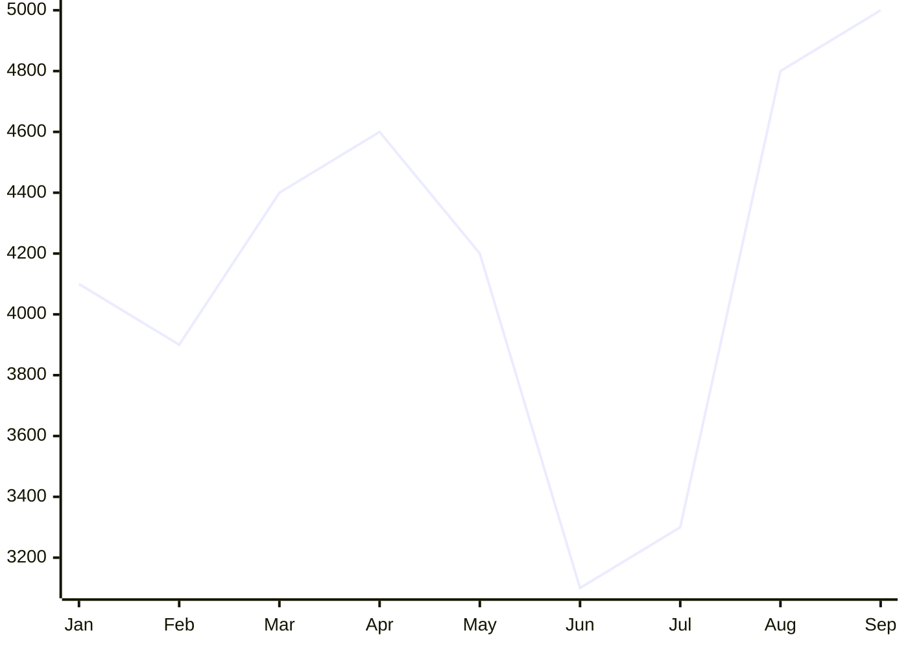
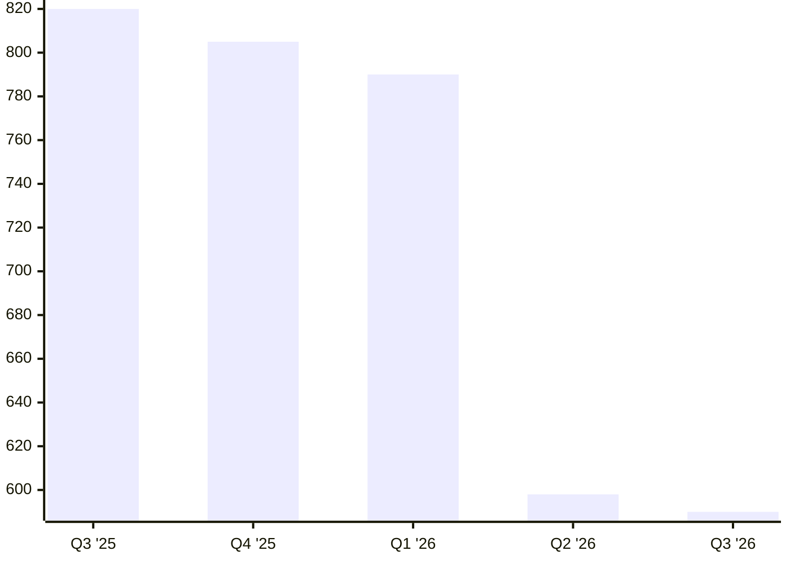
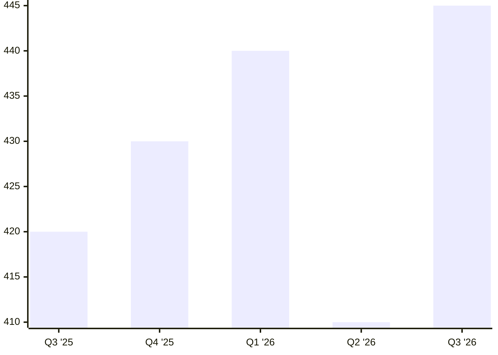

# City library services review, FY26

<!-- Test fixture (invented data): a draft written before plotpoint, with naive
     visuals. Used for mode A (storyboard with the draft). -->

## Background

The library system runs 12 branches. This review covers the four quarters around
the Q2 2026 renovation of the Central branch.

## Café revenue

Café sales recovered after the renovation.

## Branch overview

| Branch | Visits (k) | Open hours | Staff (FTE) | Events |
| --- | ---: | ---: | ---: | ---: |
| Central | 212 | 68 | 24 | 96 |
| Riverside | 96 | 54 | 4.5 | 22 |
| (10 more branches) | | | | |

All branch metrics are also shown as a grouped bar chart of four measures for
twelve branches (48 bars).

## Loans

Print loans by quarter:

E-book loans by quarter:

## Membership

We have 48,210 active members.

## Waiting times

Average waits by branch are listed in the appendix. Individual visit waits were
also surveyed (300 visits).

## Conclusion

Loans fell during the renovation. Riverside needs attention.
